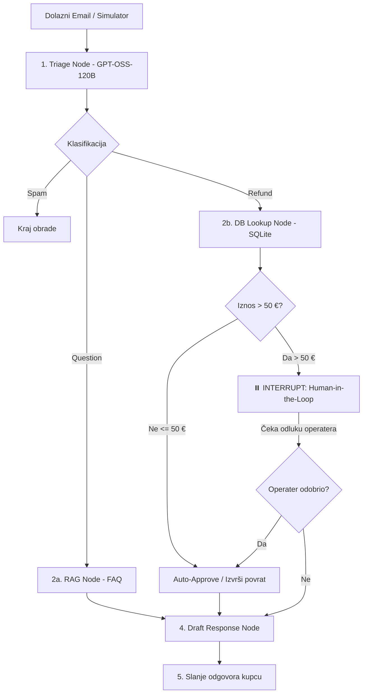

# 🤖 AI Support & Triage Agent with Human-in-the-Loop (HITL)

Produkcijski orijentiran AI sustav za automatizaciju korisničke podrške izgrađen pomoću **LangGrapha**, **Groq API-ja** i **Streamlita**. Sustav autonomno klasificira dolazne upite, provjerava stanje narudžbi u bazi podataka i primjenjuje determinističke sigurnosne guardraile za financijske transakcije.

---

## 🏗️ Arhitektura sustava



---

## ✨ Ključne značajke

* **LLM Trijaža sa strukturiranim izlazom:** Korištenje Pydantic shema (`TriageResult`) osigurava 100% deterministički JSON izlaz bez halucinacija prilikom ekstrakcije kategorije upita i ID-a narudžbe.
* **Deterministički Guardraili:** Pravila poslovnog rizika (npr. limit od `50 €` za automatski povrat) implementirana su u čistom Python kodu, a ne kroz LLM promptove.
* **Human-in-the-Loop (HITL) & Checkpointing:** Korištenjem LangGraph `SqliteSaver` checkpointera i `interrupt_before` logike, izvršavanje grafa se zamrzava prije rizičnih akcija i sprema u trajnu memoriju sve dok operater ne donese odluku u sučelju.
* **Dva načina rada:** Podržava **Live Gmail sinkronizaciju** (IMAP/SMTP putem App Passworda s `[TEST-AI]` sigurnosnim filtrom) te **Simulator** za brzo testiranje scenarija.

---

## 🛠️ Tech Stack

* **Orkestracija & State Machine:** LangGraph
* **LLM & Inference:** Groq API (`openai/gpt-oss-120b`)
* **Validacija podataka:** Pydantic
* **Baza podataka & Memorija:** SQLite (`orders.db`, `checkpoints.db`)
* **Frontend Dashboard:** Streamlit
* **Email Integracija:** Python `imaplib` / `smtplib` (Gmail App Password)

---

## 📁 Struktura projekta

```text
support-hitl-agent/
├── data/
│   ├── faq.txt             # Interna pravila poslovanja (RAG kontekst)
│   ├── orders.db           # SQLite baza narudžbi
│   └── checkpoints.db      # LangGraph trajna memorija stanja
├── src/
│   ├── app.py              # Streamlit Control Center (UI)
│   ├── graph.py            # LangGraph arhitektura, čvorovi i HITL logika
│   ├── tools.py            # Alati za rad s bazom i FAQ dokumentacijom
│   ├── gmail_service.py    # IMAP/SMTP servis za dohvat i slanje mailova
│   └── setup_db.py         # Skripta za inicijalizaciju testne baze
├── .env                    # API ključevi i konfiguracija (nije na GitHubu)
├── requirements.txt        # Python ovisnosti
└── README.md               # Dokumentacija projekta
```

---

## 🚀 Instalacija i pokretanje

### 1. Kloniranje repozitorija i virtualno okruženje
```bash
git clone https://github.com/tvoje-korisnicko-ime/support-hitl-agent.git
cd support-hitl-agent

python -m venv venv
# Windows:
venv\Scripts\activate
# Linux/Mac:
source venv/bin/activate
```

### 2. Instalacija ovisnosti
```bash
pip install -r requirements.txt
```

### 3. Konfiguracija okruženja (`.env`)
Kreiraj `.env` datoteku u korijenu projekta i dodaj svoje ključeve:
```env
GROQ_API_KEY=tvoj_groq_api_kljuc
GMAIL_USER=tvoj.email@gmail.com
GMAIL_APP_PASSWORD=tvoja16znamenkastalozinka
```

### 4. Inicijalizacija baze i pokretanje aplikacije
```bash
python -m src.setup_db
streamlit run src/app.py
```

---

## 🧪 Kako testirati?

1. **Simulator Mod:** Otvori aplikaciju u pregledniku, odaberi tab *Simulator dolaznih mailova* i testiraj različite narudžbe iz baze (npr. `ORD-101` za automatski povrat od 25 € ili `ORD-102` za aktivaciju HITL pauze na 149.99 €).
2. **Live Gmail Mod:** Pošalji email na svoju adresu s oznakom `[TEST-AI]` u naslovu (npr. `[TEST-AI] Povrat ORD-106`) i klikni *Provjeri nove mailove* u sučelju.